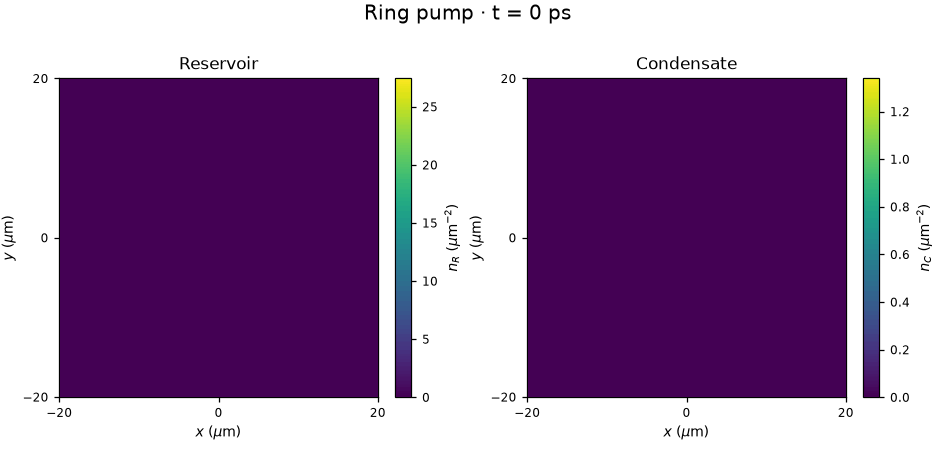

# Polariton Condensate

Numerical study of a driven–dissipative exciton–polariton condensate coupled to
an incoherent reservoir: homogeneous dynamics, localized pumping, condensation
thresholds and vortex formation.

**[English report](latex/report_en.pdf)** · [Russian report](latex/report.pdf) ·
[Notebook](polariton_condensate.ipynb) · [Methods](docs/methods.md) ·
[Recorded numerical checks](docs/diagnostic_summary.md)



## Results and methods

- Compare the full homogeneous model with adiabatic and Stuart–Landau reductions.
- Find linear instability thresholds for Gaussian and ring pumps.
- Follow a ring condensate to 2000 ps: the recorded seed produces a vortex with
  **q = −3** and **Lz/(ħ NC) ≈ −3**.
- Check particle balance, stationarity, spatial boundaries, spectral tails,
  and sensitivity to spatial and temporal steps.

The 0D dynamics use adaptive **DOP853**. The 2D solver combines **FFT kinetic
steps**, **Strang splitting** and a coupled local **RK4** step; the full split
scheme is second order in time. Units are µm, ps and meV. Model parameters follow
[Alyatkin et al. (2024)](https://doi.org/10.1126/sciadv.adj1589).

The final ring checks use the same continuous initial seed, including independent
spatial and temporal refinements to 2000 ps. They establish numerical convergence
for this configuration; they do not establish universal selection of q = −3 or
stability against arbitrary physical perturbations.

## Quick start

Tested with **Python 3.13**. From the repository root:

```bash
python3 -m venv .venv
source .venv/bin/activate
pip install -r requirements.txt
jupyter lab polariton_condensate.ipynb
```

The notebook opens saved results and runs a **64², 2 ps demonstration**. Long
simulations and optional checks are controlled by `DO_*` flags, initially false.
The committed figures and reports are available without running any calculations.

## Reproduce figures or run simulations

Redraw all nine PNGs using the included portable data, without time integration:

```bash
MPLBACKEND=Agg .venv/bin/python -c "from plotting import make_report; make_report(output_dir='results/preview')"
```

The notebook also exposes full simulations. Exact reference configurations are
`report_gaussian` (512², Δt = 0.025 ps, 500 ps) and `report_ring` (512²,
Δt = 0.05 ps, 2000 ps), both in a 256 × 256 µm² domain:

```python
from numerics import load_config, simulate_2d
run = simulate_2d(load_config("report_ring"))
# Resume the same run from its checkpoint:
run = simulate_2d(load_config("report_ring"), resume_dir=run["path"])
```

Full simulations may take tens of minutes. The 20-minute setting is a runtime
recommendation, not a forced stop. New runs go to the ignored `results/runs/`.

## Project layout

```text
polariton_condensate.ipynb  Main interface: preview, short example, optional research runs
model.py                   Equations, parameters, pump profiles and 0D solutions
numerics.py                FFT solver, diagnostics, checkpoints and research workflows
plotting.py                Figures, animations and portable-data export
config.yaml                Demo and physical scenarios, including exact reference profiles
test_project.py            One small test suite
requirements.txt           Pinned dependencies
latex/                     Russian/English report sources, PDFs and Appendix B
docs/                      Methods and recorded validation results
results/report_figures/    Nine report PNGs, two GIFs and the original source registry
results/analysis_data/     Portable NPZ and JSON with configurations and recorded checks
```

`report_data.npz` retains the original homogeneous samples, complex final fields,
reservoirs, ring populations and four transient density maps. `report_metadata.json`
records configurations, source hashes, thresholds and completed research checks.
Full fields and reservoirs are not downsampled for the final-state figures.

About **6 GB of original run histories and checkpoints remain local**, outside Git.
The portable data are sufficient to redraw all report figures. Regenerating the
GIFs or repeating the historical archive-dependent convergence workflows requires
the full local archive. Historical `run_id` paths in metadata identify provenance;
they are not required by `make_report` or the default notebook.

To rebuild the portable data from the full archive:

```bash
.venv/bin/python -c "from plotting import export_report_data; export_report_data()"
```

## Checks

```bash
.venv/bin/python -m pytest -q -p no:cacheprovider
```

The existing **38 checks** run in a few seconds on the development machine.
The suite covers exact limits, 0D/2D agreement,
phase and current conventions, checkpoint continuation and stationarity detection.

## Build the reports

With a TeX distribution, `latexmk`, and Russian language support installed:

```bash
cd latex
latexmk -pdf -interaction=nonstopmode -halt-on-error report.tex
latexmk -pdf -interaction=nonstopmode -halt-on-error report_en.tex
latexmk -c report.tex report_en.tex
```

The reports use the committed PNGs. Auxiliary TeX files are ignored by Git.
